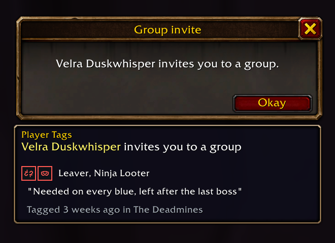
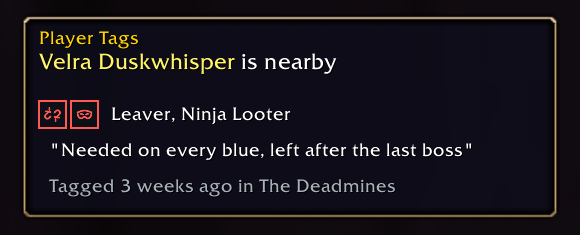
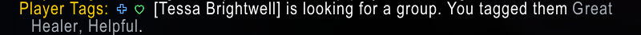
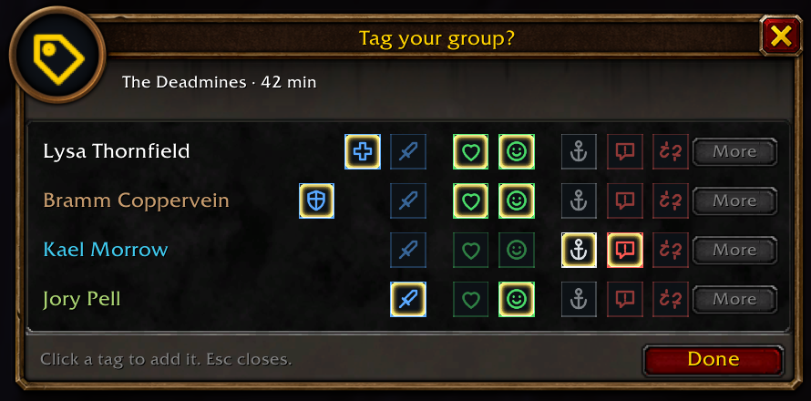
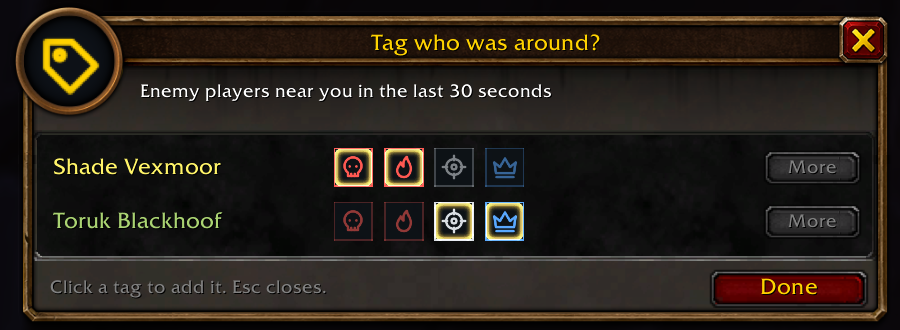
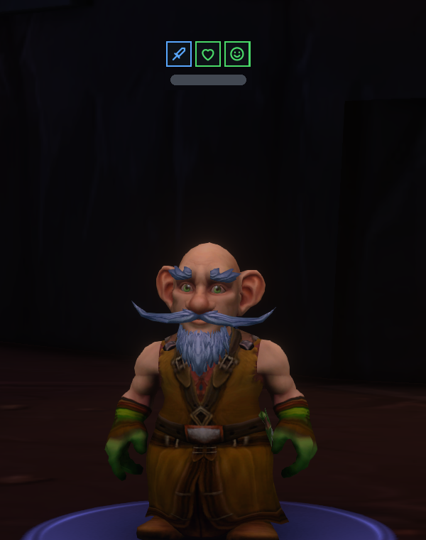
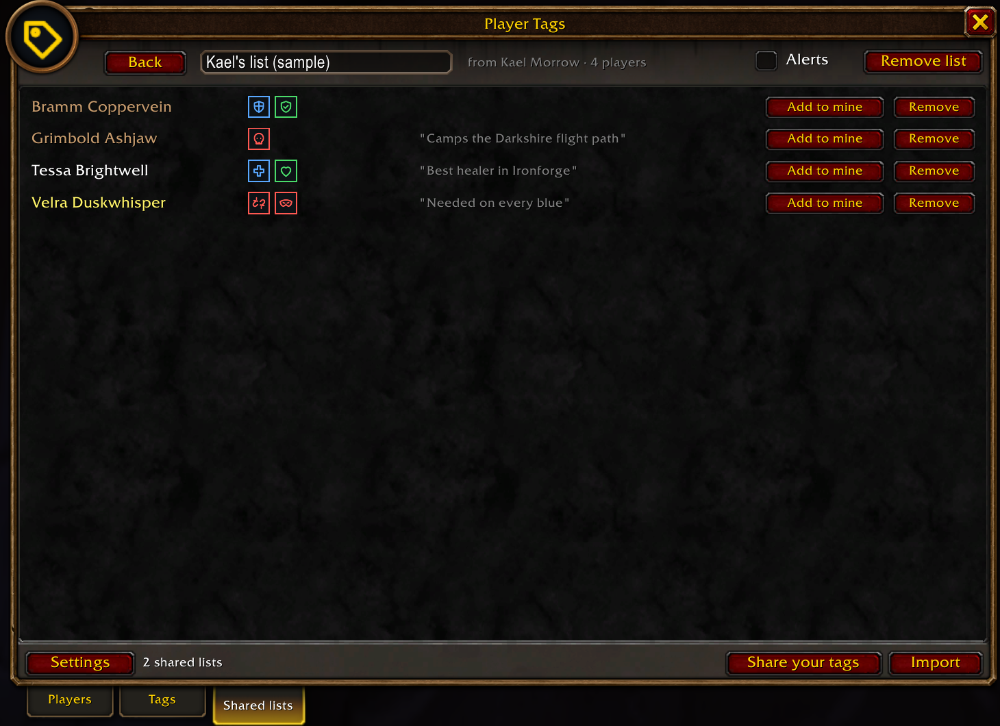
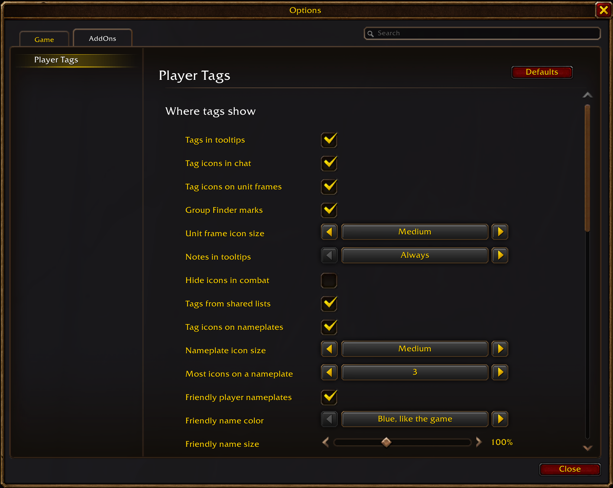
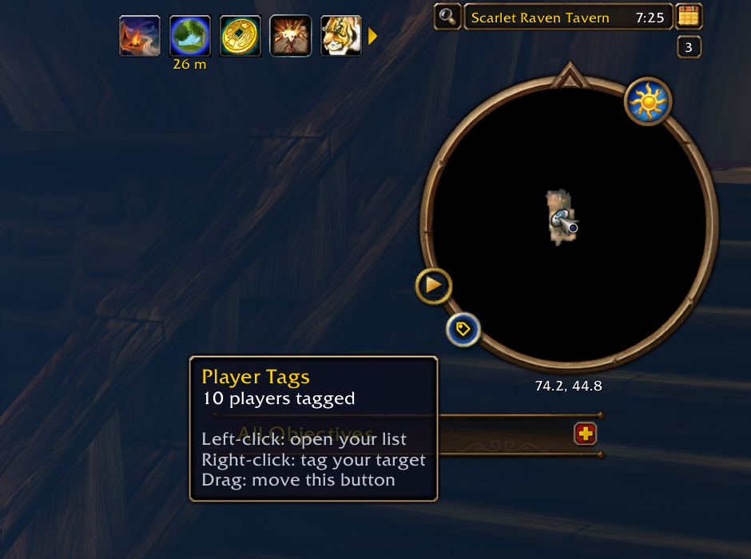

# Player Tags

**A World of Warcraft: Forever addon for remembering the people you meet.**


You run a dungeon with a healer who carries the whole group, and a week later you can't remember their name. Or someone ninjas the last drop and drops group, and a month later they're in your party again and you don't recognise them until it's too late.

Player Tags fixes that. Tag a player in a couple of clicks (Helpful, Great Healer, Ninja Looter, whatever fits) and add a note if you like. The next time you cross paths, their tags show up in their tooltip, next to their name in chat, on their target and group frames, and on their Group Finder listing.

Everything stays on your computer. Nobody else can see your tags unless you choose to give them a copy, and other players are never told you tagged them.

**[Download the latest version](https://github.com/itsMattGuenther/player-tags-wow-forever/releases/latest/download/PlayerTags.zip)** · [All releases](https://github.com/itsMattGuenther/player-tags-wow-forever/releases)

Version 1.0.1, built for WoW: Forever (interface 16001). WowUp users can try **Install from URL** with this page's address. If something looks wrong, type `/tags status` and [open an issue](https://github.com/itsMattGuenther/player-tags-wow-forever/issues) with what it says.

## What you get

**Tag anyone quickly.** Target a player and type `/tag`, press a key you bind, right-click a player or a name in chat, or right-click the minimap button. A popup opens with every tag, and you click the ones that fit.

**23 tags to start, in four families:**

| Good people | Skilled | Good to know | Avoid |
| --- | --- | --- | --- |
| Helpful | Great Tank | Hit & Run | Rude |
| Good Company | Great Healer | Quiet | Leaver |
| Generous | Big Damage | Crafter | Ninja Looter |
| Reliable | PvP God | Rival | Ganker |
| Patient | Good Leader | New Player | Scammer |
| | | Goes AFK | Griefer |
| | | Low Skill | |

You can rename them, hide the ones you don't use, and make your own.

**See tags when it matters.**

- **Tooltips:** every tag, how long ago you added it, your note, and where you were when you tagged them.
- **Chat:** small tag icons in front of the sender's name.
- **Unit frames:** target, focus, party and raid frames.
- **Groups:** a small alert box and a line in chat when someone you've tagged joins your group, plus an optional sound for Avoid tags. You can move the alert box from the settings.
- **Group Finder:** the leader's tags on a listing, and a count of other tagged players in the group.
- **Nameplates:** up to three icons by default (Avoid tags first), over enemy players in the open world.

**Heads-ups at the moment you decide.**

- **Group invites:** the inviter's tags and your note appear under the game's invite box, good tags as well as bad, before you click Accept.
- **Duels and trades:** the same, under a duel request or the trade window.
- **Whispers:** a heads-up when someone you tagged Avoid whispers you.
- **Someone you avoid is nearby:** an alert when an Avoid-tagged player's nameplate appears, you point at or target them, or they talk nearby. It skips your own group and dungeons, and waits 15 minutes before alerting about the same player again.
- **Good players looking for a group:** a line in chat, with their name to click, when someone you tagged Good people or Skilled posts in a public channel that they're looking for a group.

<p>
  
  
</p>



**Tag people while you still remember.**

- **After a group:** when a group of 5 minutes or more ends, a small window lists everyone who was in it (including anyone who left early). Each player gets the roles their class can play, your favourite good tags, and Low Skill, Leaver and Rude.
- **After a world PvP death:** a small window lists the enemy players who were near you, with Ganker and Griefer ready to click. Not in battlegrounds, where you die too often for it to be useful.

<p>
  
  
</p>

*These heads-ups and windows were captured with `/tags test`, which shows each one with made-up players. For the invite, it draws a stand-in for the game's invite box; the Player Tags part underneath is the same as with a real invite.*

Want to see them without waiting for the real thing? `/tags test` shows each one with made-up players, and nothing is saved.

**Your list.** `/tags` opens everyone you've tagged. You can search by name, tag or note, filter by family, and click a row to edit it. Names are in class colours. A grey name means the game hasn't told the addon that player's class yet. It fills in when you point at them or target them, and usually when they talk in chat.


*Hovering over a tagged player: their tags and your note in the tooltip, with tag icons above the target frame.*



*With friendly nameplates on, tag icons sit above a tagged player's name, drawn like the game's own names.*

## Private by design

- Your tags live in your own saved variables file on your computer.
- The addon contains no code that sends messages to other players. There's no public blocklist, nothing syncs, and there's no account.
- There are no scores or ratings. A tag is a note to yourself, not a public review.
- If you want to give a friend your tags, **Share your tags** (in the Shared lists tab of `/tags`) makes a block of text you hand over yourself. You choose which families go in, and your notes stay out unless you tick the box. A list you receive is kept separate from your own tags, shows with fainter icons, doesn't set off alerts unless you turn that on, and is never included when you share or back up. Remove it any time with one click.



## Install

1. Download **[PlayerTags.zip](https://github.com/itsMattGuenther/player-tags-wow-forever/releases/latest/download/PlayerTags.zip)** from the latest release.
2. Find your WoW: Forever folder. In the Battle.net app, choose World of Warcraft: Forever, click the gear next to **Play**, and pick **Show in Explorer** (**Show in Finder** on a Mac). Open the `_forever_` folder.
3. Go into `Interface`, then `AddOns`. If either folder doesn't exist, create it.
4. Unzip `PlayerTags.zip` there. You should end up with `_forever_/Interface/AddOns/PlayerTags/PlayerTags.toc`.
5. Start the game, or restart it fully if it was already running. At character select, click **AddOns** and make sure **Player Tags** is ticked.

Use the zip from the Releases page, not GitHub's green **Code → Download ZIP** button. That one puts the addon a folder too deep, and the game won't find it.

**Updating:** delete the old `PlayerTags` folder in `AddOns` and unzip the new one in its place. Your tags are stored separately, so you keep them.

## Using it

| Do this | What happens |
| --- | --- |
| Target a player and type `/tag` | The tagging popup opens. Click tags to turn them on or off, type a note, press Esc. |
| Bind a key: Options → Keybindings → AddOns → Player Tags | The same popup with one key press. It works on your target, or on the player under your mouse. |
| Right-click a player, or a name in chat → **Tag player** | The same popup. |
| `/tag rude, leaver` | Adds tags to your target without opening a window. Handy in macros. |
| `/tag note <text>` | Sets the note on your target. |
| `/untag rude` | Removes one tag. `/untag` on its own removes them all. |
| `/tags` | Opens your list. |
| Minimap button | Left-click opens your list, right-click tags your target, drag to move it around the minimap. |
| `/tags options` | The settings, which are also in the game's own menu: Esc → Options → AddOns → Player Tags. |
| `/tags tags` | The tag editor. |
| `/tags export`, `/tags import` | Back up your list as text, or restore it. Import also takes a list someone shared with you. |
| `/tags test` | Shows each heads-up and card with made-up players, for example `/tags test invite`. Nothing is saved. |
| `/tags status` | Shows what's loaded and any problems the addon caught. |

The windows look and behave like the game's own: Esc closes them, and the settings let you change their size or switch the tagging popup to a compact, icons-only version. The list and the popup open in the middle of the screen the first time. Drag them anywhere and they'll open there from then on. If you'd rather the popup opened at your mouse pointer, there's an option for that.

Player Tags is also in the game's addon menu, the small numbered button by the minimap, even if you hide its own minimap button.


## Good to know

These limits come from the game, not the addon:

- **Nameplates inside dungeons and raids:** Blizzard locks friendly nameplates there, so group frames carry the tags instead.
- **Chat inside instances:** the game hides who's talking from addons, so chat icons don't appear there.
- **Friendly nameplates in the open world:** friendly players don't have nameplates by default, so nameplate icons appear over enemy players only. Friendly players' tags still show in tooltips, chat, and on target and group frames. An option, off by default, gives friendly players name-only nameplates so icons can sit above them too. Those names are drawn to look like the game's own: the same blue, font and guild line, and never cut short. You can switch them to class colours or white, or change their size. Unticking it restores your previous settings.
- **Who's nearby:** the game only tells addons a player is near when their nameplate appears, you point at or target them, or they talk nearby. Same-faction players without nameplates are only noticed those ways.
- **Duel requests** give only a name, so the warning matches it against your list as written.
- **After a PvP death** the window lists the enemy players who were near you, not necessarily the one who landed the killing blow. The game doesn't tell addons that.

**Backing up:** `/tags export` gives you your whole list as text you can save anywhere. `/tags import` brings it back. The data itself is in `_forever_/WTF/Account/<your account>/SavedVariables/PlayerTags.lua`.

<p>
  
  
</p>

*Other players' names are hidden in these screenshots.*

## Feedback

Found a bug or have an idea for a tag? [Open an issue](https://github.com/itsMattGuenther/player-tags-wow-forever/issues). For bugs, include what `/tags status` says.

## For developers

```
PlayerTags/        the addon (this folder is what goes in Interface/AddOns)
  Core.lua         safe calls, events, module startup
  Tags.lua         families and the 23 starter tags
  Database.lua     saved data, player identity, tagging
  Shared.lua       lists other players shared with you, kept apart from yours
  Icons.lua        icon atlas, inline icons, badges
  Widgets.lua      windows and controls built from the game's own templates
  Alerts.lua       the alert box
  QuickTag.lua     the tagging popup
  Nameplates.lua   Tooltip.lua  Chat.lua  Menu.lua  Frames.lua  Group.lua  Finder.lua
  Warnings.lua     tags beside invites, duels and trades; whispers; good players seeking a group
  Nearby.lua       the heads-up when someone you avoid is near
  Cards.lua        the windows after a group and after a PvP death
  Share.lua        export / import
  Window.lua       the /tags window
  Settings.lua     the page in the game's Options, under AddOns
  Minimap.lua      the minimap button
  Slash.lua        slash commands
  Media/           glyphs.tga (icon atlas), icon.tga, minimap.tga
tests/             offline checks that run the addon against a fake game client
tools/             build_icons.py (regenerates Media/), build_store_art.py (media/), package.sh (release files)
screenshots/       images used in this README
media/             the logo for CurseForge, the GitHub social preview (not in the addon zip)
.previews/         screenshots WowUp shows on the addon's page
```

- Run the checks with `lua5.1 tests/run.lua`.
- Regenerate the icons with `python3 tools/build_icons.py`. Add new glyphs at the end and never reorder them.
- Build the release files with `tools/package.sh`. It writes `dist/PlayerTags.zip` (the stable download), the same zip as `PlayerTags-<version>-forever.zip`, and a `release.json` so WowUp knows it is for WoW: Forever.
- For local work, symlink `PlayerTags/` into `_forever_/Interface/AddOns`. `/reload` picks up code changes. New files or a changed `.toc` need a full restart of the game.

## License

MIT. See [LICENSE](LICENSE).
